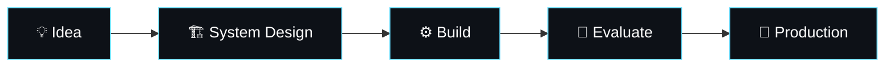

  
  
  

## 👋 About Me

I build **production-grade full-stack applications, intelligent RAG pipelines, and deep learning systems**, and I'm comfortable across the whole product lifecycle: from distributed backend architecture and vector retrieval to responsive web and mobile interfaces.

My foundations are **Python, TypeScript, and SQL**, and my work centres on four areas:

| 🌐 Full Stack Web | 🧠 AI / ML Engineering | 🏗️ System Design | ⚙️ Automation |
|---|---|---|---|
| React · Next.js · Node | RAG · Agents · Deep Learning | Scalable backends & retrieval | Pipelines that run themselves |

## 🚀 Featured Projects

<table>
  <tr>
    <td width="50%" valign="top">
      
       
      💸 <b>AI Finance Controller.</b> Automated multi-stage payment reconciliation engine (exact + fuzzy matching) with <b>LLM adjudication</b> for high-volume transactions across UPI, Cards, and Wallets.
        
      <code>FastAPI</code> · <code>React</code> · <code>Tailwind CSS</code> · <code>OpenAI</code> · <code>Python</code> · <code>Pandas</code>
    </td>
    <td width="50%" valign="top">
      
       
      🎙️ <b>Lenny Growth Assistant.</b> Citation-grounded <b>RAG</b> engine over podcast transcripts, with Ship30for30 essay synthesis and live sandboxed Markdown/HTML artifact generation. Swappable between cloud models and local Ollama.
        
      <code>FastAPI</code> · <code>pgvector</code> · <code>PostgreSQL</code> · <code>Ollama</code> · <code>Next.js</code> · <code>SQLAlchemy</code>
    </td>
  </tr>
  <tr>
    <td width="50%" valign="top">
      
       
      🩺 <b>Federated Outbreak Detection.</b> Privacy-preserving <b>federated learning</b> clinical decision support platform for distributed disease outbreak surveillance and patient risk stratification.
        
      <code>Python</code> · <code>Streamlit</code> · <code>Federated Learning</code> · <code>Scikit-Learn</code> · <code>Plotly</code>
    </td>
    <td width="50%" valign="top">
      
       
      🎭 <b>FaceSwap Deep Learning Pipeline.</b> High-fidelity video face swapping powered by a <b>shared-encoder dual-decoder</b> autoencoder, MTCNN detection, and Delaunay triangulation blending.
        
      <code>PyTorch</code> · <code>OpenCV</code> · <code>CUDA</code> · <code>Computer Vision</code>
    </td>
  </tr>
  <tr>
    <td colspan="2" valign="top" align="center">
      
       
      📱 <b>Uyir.</b> Cross-platform emergency health response application designed for rapid onboarding and real-time coordination.
        
      <code>React Native</code> · <code>TypeScript</code> · <code>Node.js</code> · <code>Mobile</code>
    </td>
  </tr>
</table>

## 🛠️ Tech Stack

### Languages & AI/ML

  
  

### Frontend & Mobile

  
  

### Databases, Retrieval & Cloud

  
  

## 📊 GitHub Stats

## 🤝 Let's Build Something

Open to conversations about **full-stack products**, **RAG and agentic systems**, and **applied deep learning**.

📫 [jaydheshiv01@gmail.com](mailto:jaydheshiv01@gmail.com) · 💼 [LinkedIn](https://www.linkedin.com/in/jaydheshiv)

